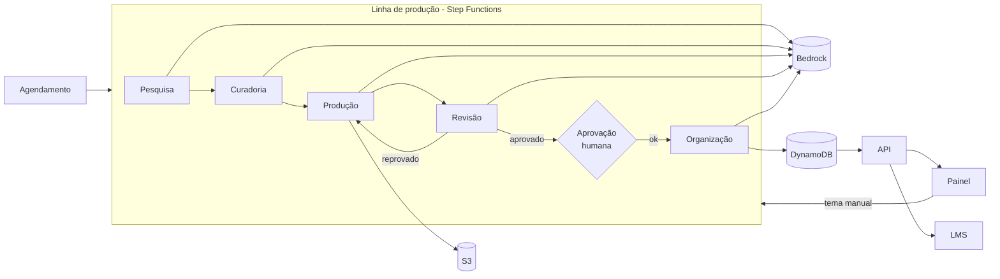

# Arquitetura

## Fluxo geral

## Peças da solução

A ideia é usar serviços gerenciados da AWS e pagar só pelo que roda, já que a produção acontece em lotes e não o dia inteiro.

**Step Functions** controla a linha de produção. Escolhi ele porque já entrega boa parte do que o cliente pediu sem eu ter que construir: status de cada etapa, histórico de cada execução, nova tentativa quando algo falha e a pausa para esperar a aprovação humana.

**EventBridge Scheduler** dispara a pesquisa de tempos em tempos (por exemplo, uma vez por semana). Também dá para disparar na mão pelo painel quando alguém quiser um tema específico.

**Lambda** roda cada agente separado, cada um com o seu prompt e a sua versão.

**Bedrock** é onde estão os modelos. Uso dois níveis: um mais barato para tarefas de triagem e um mais forte para escrever e revisar.

**DynamoDB** guarda o catálogo, as versões dos cursos, as escolhas de cada empresa e o histórico de aprovações.

**S3** guarda o conteúdo em si, o áudio das aulas e os pacotes exportados para o LMS.

**Polly** gera a narração das aulas em português, para quem prefere ouvir.

**API Gateway** expõe a API usada pelo painel e pela integração com o LMS.

O **painel** é um front-end web simples, com login via **Cognito**. Logs, métricas de custo e alertas ficam no **CloudWatch**, e a infraestrutura toda é criada com **CDK**.

## Alguns cuidados de projeto

Cada agente devolve dados num formato fixo, validado antes de seguir para o próximo. Se a IA devolver algo fora do esperado, o próprio agente pede para ela corrigir. Isso evita que um erro lá no começo vá passando pela linha inteira.

Os prompts ficam versionados no repositório junto com o código. Qualquer mudança neles passa por revisão e pode ser desfeita.

## Em qual conta da AWS

Ainda precisa ser decidido com o cliente (está no doc 09). Minha recomendação é rodar na conta dele, para que os dados e a fatura fiquem com ele desde o início.
