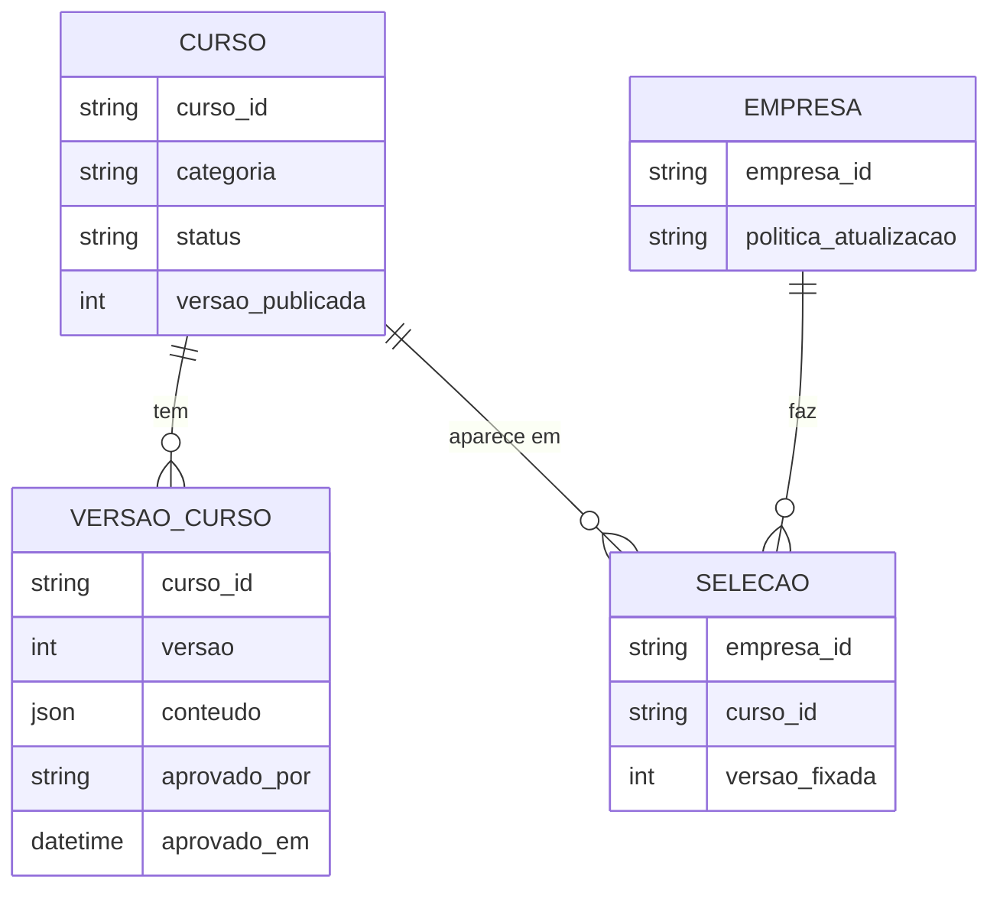

# Biblioteca e seleção por empresa

O pedido é: todos os cursos aprovados ficam numa biblioteca geral e cada empresa escolhe os que quiser, sem mexer na escolha das outras.

## Como pensei o modelo

O curso existe uma vez só. O que cada empresa guarda é a lista dos cursos que escolheu. Assim, quando um curso é corrigido, a correção chega para todo mundo que usa, sem ninguém ficar com cópia desatualizada.

## Regras

Cada empresa só enxerga as próprias escolhas. Isso não fica a cargo do front-end: toda consulta filtra pela empresa que vem no token de acesso.

A empresa decide como quer receber atualizações. Pode receber automaticamente sempre que sair uma versão nova, ou preferir revisar antes e manter a versão atual até lá.

Se um curso for retirado do catálogo, ele some da vitrine, mas continua disponível para quem já tinha escolhido até a empresa tirar.

## O catálogo

Busca por texto e filtros por categoria, nível, público e tags. Ordenação por mais novos e mais usados, um aviso quando um curso tem versão nova e a opção de adicionar vários de uma vez (por exemplo, todos de atendimento).

## Ponto em aberto

Preciso entender como o LMS já trata empresas e usuários para decidir se a seleção fica no nosso módulo ou dentro do próprio LMS.
